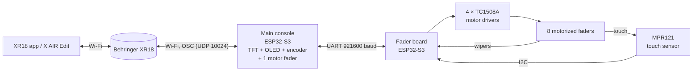

# xrpad: a DIY control surface for the Behringer XR18

A hardware console for the Behringer XR18 digital mixer, built on ESP32-S3
boards and talking to the mixer over Wi-Fi with OSC. It has:

- **8 motorized, touch-sensitive bank faders** that follow banks of channels
  (1–8, 9–16, returns, buses, DCAs) and move smoothly when levels change in
  the app.
- **A motorized "selected channel" fader** on the main console.
- **A 4.0" touchscreen** showing the selected channel in detail (level and
  meter, EQ curve, gate, compressor, preamp, sends, insert FX), with pages for
  editing each section, plus a home screen with channel strips, meters, FX
  and mixer info.
- **A rotary encoder** for picking channels and editing whatever setting is
  tapped on the screen (press to reset it to its default).
- **A small OLED** with a compact readout.
- **A Wi-Fi picker** with an on-screen keyboard, saved networks and automatic
  mixer discovery.
- **A power-up show:** all faders calibrate together, then a wave rolls across
  them before they go to their levels.



---

## Contents

- [Hardware](#hardware)
- [Wiring: main console](#wiring-main-console)
- [Wiring: fader board](#wiring-fader-board)
- [Power](#power)
- [Building and flashing](#building-and-flashing)
- [First start](#first-start)
- [Using it](#using-it)
- [How the faders move](#how-the-faders-move)
- [Board link protocol](#board-link-protocol)
- [USB debug commands](#usb-debug-commands)
- [Troubleshooting](#troubleshooting)
- [Repository layout](#repository-layout)

---

## Hardware

| Qty | Part | Notes |
|---|---|---|
| 2 | **LCKFB (立创) ESP32-S3 core board, N8R8** | 8 MB flash, 8 MB octal PSRAM. One for the main console, one for the fader board. G43/G44 are **not** on its headers. |
| 9 | **10 kΩ linear motorized faders** with touch track | 8 bank faders + 1 on the main console. |
| 5 | **TC1508A dual motor driver** modules | 4 on the fader board (2 faders each) and 1 on the main console. |
| 1 | **MPR121** capacitive touch module | Touch for the 8 bank faders. |
| 1 | **4.0" ST7796 SPI TFT with XPT2046 touch** | 480 × 320. |
| 1 | **SSD1306 128 × 64 I2C OLED, 0.96"** | Compact readout on the main console. |
| 1 | **KY-040 rotary encoder** module | With push switch. |
| 2 | **10 kΩ resistors** | Pull-downs on the fader board's G45 and G39 (see below). |
| 1 | **5 V supply for the motors** | At least 3 A recommended for 9 motors. |
| — | Wire, headers, common ground | Keep touch and I2C wires short and away from motor wires. |

### The motorized fader's pins

```
        ┌──────────────────────────────┐
        │  ███  knob / lever (touch)    │
        │   ║                           │
        │   ║   10 kΩ linear track      │
        │   ║                           │
        └──────────────────────────────┘
  track:  [TOP end] [WIPER] [BOTTOM end]      → 3V3 / ADC pin / GND
  motor:  [M+] [M-]                           → TC1508A MOTOR-A or MOTOR-B
  touch:  [T]                                 → MPR121 ELEx (or ESP32 touch pin)
```

- **TOP end** is the end the knob reaches when pushed all the way up. Wire it
  to 3V3, and the bottom end to GND.
- **Motor leads can go either way round:** calibration detects each motor's
  direction.
- **The touch pin connects to the metal lever.** It must not be shorted to the
  motor or ground; measure it open to GND with the power off.

---

## Wiring: main console

Logic is **3.3 V only**; never put 5 V on a GPIO.

```
                    LCKFB ESP32-S3 (main console)
                   ┌───────────────────────────┐
   Encoder CLK ────┤ G6                    G13 ├──── fader board RX
   Encoder DT  ────┤ G5                    G14 ├──── fader board TX
   Encoder SW  ────┤ G4                    G15 ├──── TFT CS
   Fader wiper ────┤ G7                    G16 ├──── TFT SDO + T_DO  (MISO)
   OLED SDA    ────┤ G8                    G17 ├──── TFT SDI + T_DIN (MOSI)
   OLED SCL    ────┤ G9                    G18 ├──── TFT SCK + T_CLK
   Fader touch ────┤ G10                   G38 ├──── TFT T_IRQ
   Motor IN2   ────┤ G11                   G39 ├──── TFT T_CS
   Motor IN1   ────┤ G12                   G40 ├──── TFT LED (backlight)
                   │                       G41 ├──── TFT DC
                   │                       G42 ├──── TFT RESET
                   │  3V3   GND   5V           │
                   └───────────────────────────┘
```

| Part | Pin | ESP32-S3 |
|---|---|---|
| **OLED** (SSD1306 I2C) | VCC / GND | 3V3 / GND |
| | SDA / SCL | **G8** / **G9** |
| **Encoder** (KY-040) | + / GND | 3V3 / GND |
| | CLK / DT / SW | **G6** / **G5** / **G4** |
| **Fader** (10 kΩ) | top end / bottom end | 3V3 / GND |
| | wiper | **G7** (must be ADC1: G1–G10, since ADC2 doesn't work with Wi-Fi) |
| | touch | **G10** (keep this wire short) |
| **Motor driver** (TC1508A) | + / − | 5 V motor supply / GND |
| | IN1 / IN2 | **G12** / **G11** |
| | MOTOR-A | fader motor pins |
| **TFT** (ST7796, 4.0") | VCC / GND | 5 V / GND |
| | CS / RESET / DC | **G15** / **G42** / **G41** |
| | SDI (MOSI) / SCK / SDO (MISO) | **G17** / **G18** / **G16** |
| | LED (backlight) | **G40** |
| **TFT touch** (XPT2046) | T_CLK / T_DIN / T_DO | **G18** / **G17** / **G16** (shared SPI) |
| | T_CS / T_IRQ | **G39** / **G38** |
| **Fader board link** | to its RX / from its TX | **G13** / **G14** (plus GND) |
| *Second fader board* | *to its RX / from its TX* | *G1 / G2 (only for the two-board setup, see below)* |

---

## Wiring: fader board

One ESP32-S3 drives all 8 bank faders. Touch comes from an MPR121 on I2C.

```
                     LCKFB ESP32-S3 (fader board)
                   ┌──────────────────────────────┐
 Fader 1 wiper ────┤ G1                       G9  ├──── Fader 1 IN1
 Fader 2 wiper ────┤ G2                       G10 ├──── Fader 2 IN1
 Fader 3 wiper ────┤ G3                       G11 ├──── Fader 3 IN1
 Fader 4 wiper ────┤ G4                       G12 ├──── Fader 4 IN1
 Fader 5 wiper ────┤ G5                       G13 ├──── Fader 5 IN1
 Fader 6 wiper ────┤ G6                       G14 ├──── Fader 6 IN1
 Fader 7 wiper ────┤ G7                       G15 ├──── Fader 7 IN1
 Fader 8 wiper ────┤ G8                       G16 ├──── Fader 8 IN1
                   │                              │
 Fader 1 IN2   ────┤ G17                      G47 ├──── MPR121 SDA
 Fader 2 IN2   ────┤ G18                      G48 ├──── MPR121 SCL
 Fader 3 IN2   ────┤ G21                      G45 ├──┬─ TX → main G14
 Fader 4 IN2   ────┤ G38                          │  └─ 10 kΩ → GND
 Fader 5 IN2   ────┤ G39 ─┬─ 10 kΩ → GND      G46 ├──── RX ← main G13
 Fader 6 IN2   ────┤ G40  │                       │      (unplug to flash)
 Fader 7 IN2   ────┤ G41  └ (stops fader 5        │
 Fader 8 IN2   ────┤ G42     moving at boot)      │
                   │   3V3          GND           │
                   └──────────────────────────────┘
```

### Faders

| Fader | Wiper | Top / bottom end | Motor IN1 | Motor IN2 | Touch |
|---|---|---|---|---|---|
| 1 | **G1** | 3V3 / GND | **G9** | **G17** | MPR121 **ELE0** |
| 2 | **G2** | 3V3 / GND | **G10** | **G18** | **ELE1** |
| 3 | **G3** | 3V3 / GND | **G11** | **G21** | **ELE2** |
| 4 | **G4** | 3V3 / GND | **G12** | **G38** | **ELE3** |
| 5 | **G5** | 3V3 / GND | **G13** | **G39** | **ELE5** |
| 6 | **G6** | 3V3 / GND | **G14** | **G40** | **ELE6** |
| 7 | **G7** | 3V3 / GND | **G15** | **G41** | **ELE7** |
| 8 | **G8** | 3V3 / GND | **G16** | **G42** | **ELE8** |

ELE4 and ELE9–ELE11 are left empty. The mapping is `MPR_ELECTRODE[]` in the
sketch.

### Motor drivers (TC1508A, two faders each)

```
   ESP32 ──IN1──┐  ┌────────────┐
   ESP32 ──IN2──┼─▶│  TC1508A   │──MOTOR-A──▶ fader motor (odd fader)
   ESP32 ──IN3──┤  │            │
   ESP32 ──IN4──┘  │            │──MOTOR-B──▶ fader motor (even fader)
   5 V motor ──+──▶│            │
   GND ───────−──▶ └────────────┘
```

| Driver | Channel A (IN1, IN2 → MOTOR-A) | Channel B (IN3, IN4 → MOTOR-B) |
|---|---|---|
| 1 | Fader 1: IN1 ← G9, IN2 ← G17 | Fader 2: IN3 ← G10, IN4 ← G18 |
| 2 | Fader 3: IN1 ← G11, IN2 ← G21 | Fader 4: IN3 ← G12, IN4 ← G38 |
| 3 | Fader 5: IN1 ← G13, IN2 ← G39 | Fader 6: IN3 ← G14, IN4 ← G40 |
| 4 | Fader 7: IN1 ← G15, IN2 ← G41 | Fader 8: IN3 ← G16, IN4 ← G42 |

### MPR121

| MPR121 | ESP32-S3 |
|---|---|
| VCC | **3V3** (not 5 V, unless your module has a regulator) |
| GND | GND |
| SDA / SCL | **G47** / **G48** |
| ADDR | GND (address 0x5A) |
| IRQ | not connected |

If the module has **SDA** and **CL** solder jumpers on the back, bridge them to
enable its I2C pull-ups. Leave **ADD** open when ADDR is wired to GND, and
leave **IRQ** open.

### Link to the main console

| Fader board | Main console |
|---|---|
| **G45** (TX) | **G14** |
| **G46** (RX) | **G13** |
| GND | GND |

### The two pull-down resistors (important)

| Resistor | Why |
|---|---|
| **10 kΩ, G45 → GND** | G45 is a strapping pin. Pulled high at power-up, it switches the flash to 1.8 V and the board may not boot. |
| **10 kΩ, G39 → GND** | G39 is high during boot, before the firmware runs, which drives fader 5 up to its top stop. |

> **Flashing the fader board:** unplug the **G46** wire first. The main
> console holds it high, and G46 high with G0 low blocks download mode.
> Plug it back in afterwards.

### Alternative: two 4-fader boards, no MPR121

The firmware also supports touch on the ESP32's own touch pins (set
`NATIVE_TOUCH = true` and `FADERS = 4`). Then each board runs faders 1–4
with touch on **G5–G8**, and the link uses **TX G48 / RX G47**. Two such
boards run the same firmware:

- board 1 links to the main console's **G13/G14** and drives bank faders 1–4;
- board 2 links to **G1/G2** and drives bank faders 5–8.

The main console maps them automatically. Touch this way is less robust than
the MPR121, so it's only meant as a stop-gap.

---

## Power

```
   5 V motor supply (≥ 3 A) ──┬──▶ TC1508A + (×5)
                              │
   GND ───────────────────────┴──▶ TC1508A −, both ESP32 GNDs, MPR121 GND
                                    (ALL grounds shared)

   USB (or 5 V pin) ──▶ each ESP32-S3 ──3V3──▶ fader tracks, MPR121, OLED, encoder
   5 V ──▶ TFT VCC
```

- **Keep the motors on their own supply.** Motor current dips on the logic
  supply cause resets and failed calibrations.
- **Calibration and bank switches move all faders at once.** Calibration runs
  at 70% power with a soft start, and each fader lets go as soon as it reaches
  its end, so a modest supply copes. If calibration fails with a weaker
  supply, lower `POWER` in `calibrateEnds()`.

---

## Building and flashing

### Toolchain

- **Arduino ESP32 core** 3.3.x (`esp32:esp32`)
- **Libraries:**

| Library | Used by | Tested version |
|---|---|---|
| LovyanGFX | main console (TFT + touch) | 1.2.28 |
| U8g2 | main console (OLED) | 2.34.22 |
| Adafruit MPR121 (+ Adafruit BusIO) | fader board | 1.2.1 (+ 1.17.4) |

### Board settings

The LCKFB board is **N8R8**, so build for 8 MB flash. Building for 16 MB
crash-loops at boot.

```
FQBN: esp32:esp32:esp32s3:FlashSize=8M,PSRAM=opi,CDCOnBoot=cdc,PartitionScheme=default_8MB
```

In the Arduino IDE that's: *ESP32S3 Dev Module*, Flash Size **8MB**, PSRAM
**OPI PSRAM**, USB CDC On Boot **Enabled**, Partition Scheme **8M with spiffs**.

### Wi-Fi defaults (optional)

```sh
cp xr_console/secrets.example.h xr_console/secrets.h
```

Edit it with your network. It's only a default: networks picked on the
touchscreen are saved on the board. `secrets.h` is git-ignored.

### Flashing with arduino-cli

```sh
FQBN="esp32:esp32:esp32s3:FlashSize=8M,PSRAM=opi,CDCOnBoot=cdc,PartitionScheme=default_8MB"

# main console
arduino-cli compile --upload -p /dev/cu.usbmodemXXXX --fqbn "$FQBN" xr_console

# fader board (unplug its G46 link wire first)
arduino-cli compile --upload -p /dev/cu.usbmodemYYYY --fqbn "$FQBN" xr_fader_board
```

USB port names change when boards are replugged. To tell boards apart, read
their MAC address:

```sh
esptool --port /dev/cu.usbmodemXXXX --after hard-reset read-mac
```

### Configuration constants

| Sketch | Constant | Meaning |
|---|---|---|
| `xr_fader_board` | `FADERS` | faders fitted (8) |
| | `NATIVE_TOUCH` | `false` = MPR121, `true` = ESP32 touch pins (4 faders max) |
| | `MPR_ELECTRODE[]` | MPR121 electrode for each fader |
| | `POT_REVERSE[]`, `MOTOR_REVERSE[]` | flip a fader's reading or motor if wired backwards |
| | `MOVE_VMAX`, `MOVE_AMAX` | glide top speed and acceleration |
| `xr_console` | `MOTOR_REVERSE`, `POT_REVERSE` | same for the console's own fader |
| | `FB2_TX`, `FB2_RX`, `FB2_FIRST` | second fader board link (two-board setup) |
| | `MOVE_VMAX`, `MOVE_AMAX` | glide speed for the console's fader |

---

## First start

1. **Fader board:** all 8 faders run to their bottom stops together, then to
   the top, measuring each fader's travel and motor direction. Then the wave
   show plays and the faders drop to the bottom.
2. **Main console:** the fader calibrates in the same way. On the first boot
   the TFT asks you to tap targets to calibrate the touchscreen. To redo it
   later, use settings, or hold a finger on the screen while the console
   starts.
3. **Wi-Fi:** the console joins the most recently used saved network in range,
   otherwise it shows a network picker. The XR18's own access point works
   (open network).
4. **Mixer:** the console finds the XR18 automatically (`/xinfo`), shows a sync
   screen while it reads every channel, then the home screen. The faders fly
   to their channels' levels.

---

## Using it

### Home screen tabs

| Tab | Shows | Bank faders control |
|---|---|---|
| **1-8** | channels 1–8 | channels 1–8 |
| **9-16** | channels 9–16 | channels 9–16 |
| **RTN** | AUX, FX returns, MAIN | AUX, FX return 1–4, MAIN |
| **BUS** | buses and FX sends | bus 1–6, FX send 1–2 |
| **DCA** | DCAs and FX sends | DCA 1–4, FX send 1–4 |
| **METERS** | all meters | (keep the last bank) |
| **FX** | FX slots | (keep the last bank) |
| **MIXER** | mixer and fader board status | (keep the last bank) |

The tab the faders are currently on is underlined. Each strip shows its
fader number in a circle, which turns white while that fader is touched.

### Faders

- **Bank faders** move to the bank's levels and follow changes from the app.
  Touch one and move it to set that level; touching it also selects that
  channel on the big screen. Stereo-linked channels move together.
- **The console's own fader** follows the selected channel. If you grab it
  while it's moving, the motor lets go and it falls back to *pickup*: it takes
  control once moved past the channel's level, with an arrow showing which
  way.
- **Noise never moves the mixer.** A fader only sends changes while it's
  being touched.

### Encoder and touchscreen

- **Turn** the encoder to pick a channel.
- **Tap** any setting on the TFT to point the encoder at it. Tap it again to go
  back to changing channels.
- **Press** the encoder to reset the setting to its default.
- **EQ, gate, compressor, sends, preamp and insert FX** have their own editing
  pages; tap a section to open it.
- **The gear** in the header opens settings (network, touchscreen
  calibration).

---

## How the faders move

- **Smooth drive:** each motor runs drive/brake ("slow decay") PWM in both
  directions, so its speed follows the power evenly from about 25–30% up.
  The old drive/coast mode needed 70% power to move at all in one direction.
- **Glide:** each move follows a setpoint that speeds up, cruises and eases
  into the target. The motor tracks it with feed-forward (friction plus
  speed) plus position and speed correction, and a gradual push if it sticks.
  It brakes briefly at the end so it doesn't slide on.
- **Streams:** a run of targets (dragging in the app, turning the encoder, a
  linked partner) plays back as straight lines between the received values,
  so the fader moves continuously instead of stopping at each step.
- **Safety:**
  - a hand on a fader stops its motor at once;
  - a fader held far from its glide lets go;
  - a fader that fails calibration is disabled rather than driven blind.

---

## Board link protocol

UART, 921600 baud, 8N1, text lines.

| Direction | Line | Meaning |
|---|---|---|
| main → board | `T <n> <pos>` | move fader *n* (0–7) to *pos* 0–1000; *pos* < 0 = no target |
| main → board | `C` | recalibrate all faders |
| main → board | `?` | ask for the hello line |
| board → main | `H <faders> <touch>` | hello: fader count, touch sensor present (at boot and on `?`) |
| board → main | `S <mask> <p0> … <p7>` | every 20 ms: touched faders (bit mask) and positions 0–1000 (−1 = unknown) |

The main console re-sends every target every 2 s in case a line was lost. The
fader board only moves a fader when its target actually changes.

---

## USB debug commands

Type these into a serial monitor at 115200 baud.

**Fader board:**

| Command | Does |
|---|---|
| `C` | recalibrate |
| `M <n>` | motor test on fader *n* (`M 0` = all) |
| `X` | all motors off / on |
| `V <n>` | speed-vs-power sweep on fader *n* |
| `G <n> <pos>` | move fader *n* to *pos* (0–1000) and record it |
| `S <n> <from> <to> <ms> <step>` | send a stream of targets, like the app |
| `R` | print the last recording (time, setpoint, position, power every 2 ms) |
| `P <n> <power>` | hold a fixed power (−1000…1000) for 300 ms, recorded |
| `L` | hand control back to the main console after `G`/`S` |
| `Q <µA> <t>` | set the MPR121 charge current and time and print readings |

**Main console:** `V` (sweep), `G <pos>`, `S <from> <to> <ms> <step>`, `R`.

Every 2 s the fader board prints a status line: link traffic, each fader's
position > target, its raw reading and calibration, and MPR121 readings and
baselines. It also logs each pad touch and release.

---

## Troubleshooting

| Symptom | Likely cause / fix |
|---|---|
| A fader says `calibration failed … disabled` | The motor isn't moving: a broken motor wire, a driver input not connected, or the supply sagging. Run `M <n>` to test it. |
| A fader runs to the top as soon as the board powers up | A driver input floats high during boot. Add a 10 kΩ pull-down (G39 for fader 5). |
| Fader board won't flash | Unplug the G46 link wire while flashing. |
| Fader board doesn't boot (or boot-loops) after wiring the link | G45 is pulled high at power-up: add the 10 kΩ pull-down from G45 to GND. |
| All MPR121 readings near zero (about 2–20) | Auto-setup must be on (`mpr.begin(…, true)`). With it off, the Adafruit library still leaves auto re-tuning on with no targets, which fails. |
| One fader's touch reads near 0 or is flagged out of range | Its touch wire is shorted to ground or the motor. Measure it with the power off. |
| One fader's touch reads normally but never changes | Its touch wire isn't reaching the fader's touch contact. |
| Touch reads oddly after rewiring | Reset the fader board: the MPR121 tunes each input at startup. |
| Faders don't move after a cold start | The motor supply came up after the board, so calibration ran with no power. Reset the fader board, or switch the motor supply on first. |
| Calibration fails on several faders at once | The supply can't take every motor together. Lower `POWER` in `calibrateEnds()`, or use a bigger supply. |
| A fader moves the wrong way, or upside down | Its track ends are swapped: set its `POT_REVERSE`. Motor direction is detected automatically. |
| Console can't find the mixer | Set `XR18_IP` in `secrets.h`, or check you're on the mixer's network. |

---

## XR18 OSC notes

- **Port:** UDP 10024.
- **Discovery:** `/xinfo`.
- **Subscriptions:** `/xremote` every 8 s (the mixer drops subscriptions after
  10 s).
- **Meters:** `/meters/1` is a blob of 40 little-endian int16 values.
- **Fader law:** 0…1 maps to −∞…+10 dB.
- **Insert FX slot:** the address is `/ch/NN/insert/sel`, not the documented
  `insert/fxslot`.

---

## Repository layout

| Folder | What |
|---|---|
| `xr_console/` | **The main console**: Wi-Fi/OSC, TFT UI (`ui.h`), OLED, encoder, its motor fader, banks and the fader board link |
| `xr_fader_board/` | **The fader board**: 8 motorized faders, MPR121 touch, calibration and the power-up show |
| `xr_master_mute/` | First experiment: one button that mutes the main mix |
| `xr_fader_knob/` | Encoder + OLED: set any channel's level with a knob |
| `xr_slide_fader/` | Non-motorized slide fader with pickup |
| `xr_motor_fader/` | Single motorized fader (predecessor of the console's fader) |

Each sketch has a header comment with its own wiring.
